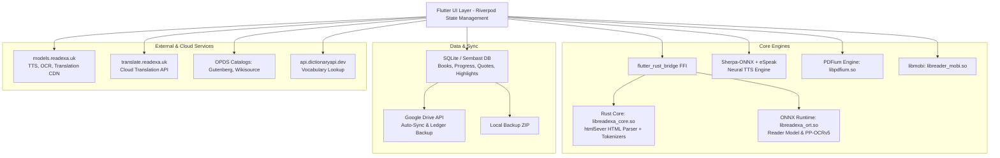

# Báo Cáo Reverse Engineering Toàn Diện Ứng Dụng Readexa (`read.xapk`)

> **Tệp phân tích:** `read.xapk`  
> **Tên ứng dụng:** **Readexa**  
> **Package Name:** `com.ync.reader_browser`  
> **Phiên bản:** `1.15.0` (Build `82`)  
> **Target SDK:** Android 36 (Android 16) | **Min SDK:** 32 (Android 12L)  
> **Tổ chức / Nhà phát triển:** YNC Mobile  
> **Định dạng gói:** XAPK (Split APK Bundle)  

---

## 1. Cấu Trúc Tổng Thể Gói Cài Đặt (XAPK Architecture)

Tệp `read.xapk` thực chất là một gói lưu trữ ZIP chuẩn Android App Bundle chứa các tệp APK phân tách (Split APKs) và cấu hình cài đặt:

```
read.xapk (98.3 MB)
├── manifest.json                 # Định nghĩa metadata của XAPK, permissions, split packages
├── com.ync.reader_browser.apk    # Base APK (38.5 MB): Mã Bytecode DEX, Flutter Assets, UI Shaders, i18n
├── config.arm64_v8a.apk          # Native Split APK (59.6 MB): Toàn bộ Native C++/Rust/AI Engines
├── config.en.apk                 # Tài nguyên ngôn ngữ tiếng Anh (53.4 KB)
├── config.fr.apk                 # Tài nguyên ngôn ngữ tiếng Pháp (32.9 KB)
└── config.xxhdpi.apk             # Tài nguyên đồ họa mật độ cao xxhdpi (66.2 KB)
```

### 1.1. Base APK (`com.ync.reader_browser.apk`)
- **4 tệp DEX** (`classes.dex` đến `classes4.dex`): Chứa bytecode Android Java/Kotlin wrapper, Android Services, Broadcast Receivers, App Widgets và các SDK bên thứ ba (Firebase, Google Play Billing, AdMob, Google ML Kit).
- **Flutter Assets (`assets/flutter_assets/`)**:
  - `AssetManifest.bin`: Danh mục toàn bộ tài nguyên nhúng (giải mã bằng Flutter StandardMessageCodec).
  - `FontManifest.json`: Cấu hình các bộ font phục vụ đọc sách (Noto Sans, Inter, Lucide, Material Icons, IBM Plex Mono, Inconsolata, Lora, Merriweather).
  - `NativeAssetsManifest.json`: Cấu hình dynamic bindings cho `pdfium_dart` và `libpdfium.so`.
  - `assets/readexa/manifest.json`: Trọng số và thông số mô hình AI nhận diện cấu trúc trang web đọc truyện (`reader.onnx`, `reader.rxw`).
  - `assets/readexa/ocr_manifest.json`: Cấu hình và URL tải các mô hình on-device OCR (PP-OCRv5).
  - `assets/js/Readability.js` & `Readability-readerable.js`: Engine bóc tách nội dung bài viết từ Mozilla.
  - `assets/translation/`: Hệ thống từ điển Han-Viet (`zh-vi.hanviet.tsv`), từ điển cụm từ (phrasebooks), thành ngữ (idioms), bảng thuật ngữ (glossary) của 18+ ngôn ngữ.
  - `assets/translations/`: Bộ bản dịch đầy đủ 2,392 khóa văn bản cho 20 ngôn ngữ (`vi.json`, `en.json`, `zh.json`, `ja.json`, `ko.json`, `fr.json`, `es.json`, v.v.).
  - `packages/flutter_page_curl/shaders/page_curl_readexa.frag`: Shader OpenGL/Vulkan lật trang 3D chân thực.

### 1.2. Native Shared Libraries (`config.arm64_v8a.apk`)
Toàn bộ mã thực thi hiệu năng cao được viết bằng Rust và C++:
| Thư viện (.so) | Kích thước | Công nghệ & Vai trò |
|---|---|---|
| `libapp.so` | 25.3 MB | Mã nhị phân Flutter AOT (toàn bộ logic Dart của ứng dụng). |
| `libflutter.so` | 11.7 MB | Flutter Engine runtime (Clang 19.0.1, Android 13624864). |
| `libreadexa_core.so` | 10.5 MB | **Rust Core Engine** (dùng `flutter_rust_bridge`, `html5ever`, `tokenizers`, `tokio`). |
| `libreadexa_ort.so` | 33.0 MB | **ONNX Runtime** tùy biến riêng cho Readexa để chạy mô hình AI phân loại văn bản và OCR. |
| `libonnxruntime.so` | 22.2 MB | Runtime suy luận ONNX chuẩn. |
| `libreadexa_sherpa.so` | 4.0 MB | Bridge tích hợp hệ thống tổng hợp giọng nói ngoại tuyến Sherpa-ONNX. |
| `libsherpa-onnx-c-api.so` | 4.5 MB | Sherpa-ONNX C API cho Text-To-Speech (TTS) ngoại tuyến. |
| `libespeak_phon.so` | 329 KB | Thư viện phiên âm âm vị học eSpeak-NG hỗ trợ đọc TTS đa ngôn ngữ. |
| `libpdfium.so` | 6.4 MB | Engine đọc và render PDF Google PDFium. |
| `libreader_mobi.so` | 114 KB | Thư viện native bóc tách định dạng E-book MOBI/AZW (`libmobi`). |
| `libtranslate_jni.so` | 16.4 MB | JNI Engine biên dịch và dịch thuật ngoại tuyến. |
| `libmlkit_google_ocr_pipeline.so` | 11.1 MB | Pipeline nhận diện ký tự quang học Google ML Kit OCR. |

---

## 2. Kiến Trúc Kỹ Thuật (Architecture & Tech Stack)

Readexa được xây dựng theo kiến trúc **Hybrid Flutter + Rust + On-Device Neural Models**:



### 2.1. Quản lý trạng thái & Module hóa
- **State Management:** `flutter_riverpod` + `rxdart`.
- **Cơ sở dữ liệu cục bộ:** `sqflite` (SQLite) cho bảng sách, lịch sử đọc, đánh dấu, trích dẫn, từ vựng; `sembast` lưu trữ dữ liệu NoSQL; `shared_preferences` lưu cấu hình người dùng.
- **Tách module tính năng (`package:reader_browser/features/`)**:
  - `home`: Màn hình chính, thẻ "Đọc tiếp", "Nghe tiếp", tiến độ mục tiêu ngày, chuỗi ngày đọc (Streak).
  - `reader`: Bộ đọc sách đa định dạng (EPUB, PDF, CBZ/Manga, Web Novel).
  - `browser`: Trình duyệt web tích hợp công nghệ AI trích xuất tiểu thuyết và bài viết.
  - `library`: Quản lý kho sách, kệ sách, danh mục series, gắn thẻ (tags), nhập sách OPDS/Drive/Local.
  - `highlights`: Quản lý đoạn đánh dấu, ghi chú, thẻ Post-it, tạo ảnh trích dẫn (Quote card).
  - `reading_stats`: Thống kê hành trình đọc, tốc độ đọc (WPM), lịch đọc chia sẻ.
  - `reviews`: Đánh giá sách, viết cảm nhận (dùng trình soạn thảo phong phú Quill).
  - `background_sound`: Âm thanh nền / tiếng ồn trắng khi đọc sách.
  - `home_widget`: Các tiện ích Widget trên màn hình chính Android.
  - `profile`: Tài khoản Google, gói Readexa Pro, cài đặt hệ thống.

---

## 3. Các Cách Kết Nối API & Dịch Vụ Mạng (Network & API Endpoints)

### 3.1. Hệ thống Backend chính của Readexa
1. **CDN Phân phối Mô hình AI (`https://models.readexa.uk`)**:
   - `GET /tts/v1`: Danh mục và gói mô hình giọng nói Piper TTS / VITS / Supertonic dạng ONNX.
   - `GET /tts/v1/sea-g2p-0.10.0-vi-en/sea_g2p.bin`: Tệp nhị phân phiên âm tiếng Việt và tiếng Anh.
   - `GET /ocr/v1/ppocrv5-mobile-1`: Bộ mô hình OCR nhận diện chữ: `det.onnx`, `cls.onnx`, `rec_zh.onnx`, `rec_ko.onnx`, `rec_latin.onnx`, cùng các file từ điển `dict_*.txt`.
   - `GET /translation/v1`: Các gói dữ liệu từ điển dịch thuật ngoại tuyến và convert tiếng Trung sang tiếng Việt.
   - `GET /bgm/v1`: Tải các tệp âm thanh nền (tiếng mưa rơi, quán cà phê, sóng biển, lò sưởi).
2. **Dịch Vụ Dịch Thuật Đám Mây (`https://translate.readexa.uk`)**:
   - Máy chủ API dịch thuật văn bản trực tuyến của Readexa, sử dụng khi người dùng yêu cầu dịch nâng cao vượt ngoài từ điển offline.
3. **OPDS Gateway (`https://opds.readexa.uk/wikisource/`)**:
   - Máy chủ proxy chuẩn OPDS kết nối đến kho sách miễn phí Wikisource tiếng Việt và quốc tế.
4. **Quy Tắc Bóc Tách Tiểu Thuyết Từ Xa (`raw.githubusercontent.com`)**:
   - URL: `https://raw.githubusercontent.com/congybk/extraction-novel/refs/heads/main/extraction_rules.json`
   - Cập nhật linh hoạt các bộ quy tắc CSS/XPath để bóc tách chương truyện từ các trang web đọc truyện mới nhất mà không cần cập nhật ứng dụng.

### 3.2. Dịch vụ bên thứ ba & Đám mây
1. **Google Drive API (Cloud Sync)**:
   - Scope: `https://www.googleapis.com/auth/drive.appdata` & `drive.file`
   - Cơ chế: Đồng bộ hai chiều ngầm dữ liệu sách, vị trí đọc dở, các đoạn highlight và từ vựng thông qua sổ cái giao dịch `book_file_sync_ledger.dart`.
2. **Kho sách mở chuẩn OPDS (Open Publication Distribution System)**:
   - Project Gutenberg: `https://m.gutenberg.org/ebooks.opds/`
   - Standard Ebooks: `https://standardebooks.org/feeds/atom/new-releases`
   - Wikisource XML: `https://ws-export.wmcloud.org/opds/...`
   - Ebooks Gratuits: `https://www.ebooksgratuits.com/opds/`
   - Textos.info: `https://www.textos.info/opds`
3. **Tra cứu từ điển (`Free Dictionary API`)**:
   - URL: `https://api.dictionaryapi.dev/api/v2/entries/{lang}/{word}`
   - Dùng để tra từ, định nghĩa, phiên âm IPA ngay trong chế độ đọc sách và thêm vào sổ từ vựng Flashcard.
4. **Kho giọng nói AI HuggingFace (`yncmobile/SRT-TTS-03`)**:
   - Lưu trữ các mô hình giọng nói AI tiếng Việt chất lượng cao: `QuangMinh.onnx`, `duyoryx3175.onnx`, `ngochuyen.onnx`, `ngocngan3701.onnx`, `phuongmai1.onnx`, `lacphi.onnx`, `VieNeu-TTS-v3-Turbo`.
5. **Firebase & Google Play**:
   - Firebase Auth (xác thực tài khoản Google), Cloud Firestore (quản lý voucher kích hoạt mã Pro `readexa.redeem.v1`), Firebase Remote Config, Crashlytics.
   - Google Play In-App Billing (`com.android.billingclient.api.BillingClient` / `in_app_purchase`).
   - Google Mobile Ads (AdMob).

---

## 4. Giao Diện Người Dùng (UI/UX) & Bản Đồ Màn Hình

Ứng dụng xây dựng một hệ thống Design System riêng (`package:reader_browser/shared/widgets/ds/` với các component tiền tố `ds_` như `ds_button`, `ds_card`, `ds_sheet`, `ds_search_bar`, `ds_chips`, v.v.).

Có tổng cộng **86 màn hình, trang và bottom sheet chuyên dụng**:

### 4.1. Màn hình chính & Điều hướng
- `tab_shell_route.dart`: Khung điều hướng đáy (Bottom Navigation Bar) cho phép tùy biến vị trí các tab.
- `home_spotlight_view.dart`: Trang chủ với giao diện thẻ lớn "Đọc tiếp" (hiển thị bìa, tên chương, % hoàn thành), "Nghe tiếp" (trình phát audio tóm tắt), mục tiêu ngày và chuỗi đọc.
- `daily_goal_sheet.dart` & `streak_details_sheet.dart`: Bảng điều khiển mục tiêu đọc (thời gian đọc mỗi ngày, lịch biểu chuỗi ngày đọc).
- `milestones_sheet.dart`: Bảng thành tựu chia theo 6 hạng mục: Nhịp đọc, Đọc sâu, Nghe sách, Hoàn thành, Ghi dấu, Mục tiêu.

### 4.2. Các chế độ đọc chuyên biệt (Reader Views)
1. **Trình đọc EPUB (`epub_reader_page.dart`)**:
   - Lật trang 3D (`page_curl_readexa.frag` / `page_flip_book_page.dart`), cuộn dọc liên tục hoặc trượt ngang.
   - Bảng mục lục chương (`epub_toc_sheet.dart`), bảng xem chú thích cuối trang dạng popup (`epub_footnote_sheet.dart`).
   - Tùy biến kiểu chữ, giãn dòng, lề, màu nền (Sáng, Tối, Vàng Sepia, Đen OLED, E-ink Grayscale và bảng màu tự chọn HEX).
   - Tùy biến vùng chạm chuyển trang (`page_turn_custom_tap_editor_page.dart`) và lật trang bằng phím âm lượng (`volume_page_turn_service.dart`).
2. **Trình đọc PDF (`pdf_reader_page.dart`)**:
   - Chế độ trang ảnh PDFium độ phân giải cao (`pdf_image_mode`).
   - Chế độ dòng chảy văn bản (`pdf_text_mode` / `pdf_reflow_view.dart`): Tự động trích xuất text để người dùng đọc như sách EPUB thông thường.
   - Tự động dò biên và cắt lề trang (`pdf_crop_zoom_sheet.dart` / `auto-fit text`).
   - Bảng lưới thu nhỏ trang (`pdf_thumbnail_grid_sheet.dart`).
3. **Trình đọc Manga / Comic (`manga_reader_page.dart` / `cbz_reader_page.dart`)**:
   - Chế độ cuộn dọc liên tục phong cách Webtoon hoặc lật trang Phải-sang-Trái (RTL chuẩn Manga).
   - Cắt viền tự động/thủ công cho từng trang hoặc toàn bộ chương (`manga_crop_sheet.dart`).
   - Tích hợp nhận diện chữ trên truyện tranh (Manga OCR) và dịch đè lên bóng thoại (`translation_detail_sheet.dart`).
4. **Trình đọc Web Novel / Bài viết (`reader_page.dart` & `browser_page.dart`)**:
   - Trình duyệt tích hợp Chromium WebView.
   - Nút chuyển đổi 1 chạm sang "Chế độ đọc" (Reader Mode).
   - Tự động nhận diện chương tiếp theo (`next`), chương trước (`prev`), mục lục (`toc`) để tải trước chương ngầm và chuyển chương mượt mà.

### 4.3. Trình phát Audio & Giọng đọc AI (TTS UI)
- `global_mini_audio_player.dart` & `mini_audio_player.dart`: Thanh phát audio nổi luôn hiển thị ở đáy màn hình xuyên suốt toàn bộ ứng dụng.
- `full_audio_player.dart`: Trình phát đầy đủ toàn màn hình, đồng bộ highlight theo câu văn đang đọc.
- `tts_voice_sheet.dart` & `tts_voice_switcher.dart`: Bộ chọn giọng đọc (chia theo giọng Nam, giọng Nữ, ngôn ngữ, cấp bậc giọng Chuẩn hoặc AI cao cấp).
- `tts_speed_sheet.dart`: Điều chỉnh tốc độ từ 0.5x đến 3.0x và cao độ giọng đọc.
- `sleep_timer_sheet.dart`: Hẹn giờ tắt (15 phút, 30 phút, 60 phút, hết chương hiện tại).
- `background_sound_sheet.dart`: Bật âm thanh nền tự nhiên kết hợp cùng giọng đọc sách.

### 4.4. Đánh dấu, Ghi chú & Từ vựng (Notebook UI)
- `highlight_bottom_sheet.dart`: Menu chọn màu highlight, thêm ghi chú.
- `postit_sheet.dart`: Dán giấy ghi chú ảo (Post-it) ngay trên trang sách.
- `ink_options_sheet.dart` & `ink_sticker_sheet.dart`: Hiệu ứng bút mực phát sáng (Ink Sparkle) và dán nhãn dán sticker.
- `quote_share_sheet.dart`: Tạo ảnh trích dẫn nghệ thuật kèm thông tin sách để chia sẻ lên mạng xã hội.
- `vocabulary_howto_sheet.dart` & `vocabulary_flashcard_mode`: Ôn tập từ vựng đã tra cứu theo thẻ Flashcard (Spaced Repetition).
- `highlight_export_preview_page.dart`: Xem trước và xuất toàn bộ ghi chú/highlight ra định dạng Markdown, JSON hoặc TXT.

### 4.5. Thư viện & Quản lý sách
- `tags_page.dart` & `tag_detail_page.dart`: Phân loại sách theo hệ thống tag màu đa dạng.
- `series_detail_page.dart` & `local_series_page.dart`: Quản lý các bộ truyện nhiều tập, tự động sắp xếp theo thứ tự chương.
- `random_book_page.dart`: Tính năng "Chọn ngẫu nhiên một cuốn sách" khi người dùng chưa biết đọc gì.
- `import_sheet.dart`: Nhập sách từ tệp cục bộ thiết bị, Google Drive, đường link web URL, hoặc quét tài liệu qua camera.

### 4.6. Android Widgets
- `ReadexaTodayWidgetProvider`: Widget hiển thị thời gian đọc hôm nay và chuỗi ngày đọc.
- `ReadexaShelfWidgetProvider`: Widget kệ sách hiển thị các cuốn sách đọc dở trên màn hình Home.
- `ReadexaReadingListWidgetProvider`: Widget danh sách bài viết / truyện chờ đọc.

---

## 5. Các Chức Năng Hỗ Trợ Độc Đáo (Feature Breakdown)

### 5.1. Bóc tách & Đọc tiểu thuyết mạng thông minh (AI Web Novel Distiller)
- Ứng dụng tích hợp mô hình AI ONNX (`reader.onnx`) được huấn luyện với 240 chiều khối văn bản và 49 chiều liên kết:
  - Phân loại khối: `content` (nội dung chính), `chapter_title` (tiêu đề chương), `novel_title` (tên truyện), `author` (tác giả), `junk` (quảng cáo/bình luận rác), `boilerplate` (menu header/footer).
  - Phân loại link: `next`, `prev`, `toc`, `other`.
  - Cơ chế tự cân bằng: Nếu mô hình AI trích xuất được số ký tự nhỏ hơn 50% so với Mozilla Readability, ứng dụng sẽ tự động kích hoạt Readability làm cứu cánh (`fallback: true`).
  - Hỗ trợ cập nhật quy tắc trích xuất từ xa không cần cập nhật app thông qua GitHub.

### 5.2. Công nghệ Text-To-Speech (TTS) Ngoại Tuyến Đa Ngôn Ngữ
- Không phụ thuộc vào Google TTS: Ứng dụng tích hợp trực tiếp **Sherpa-ONNX** và **Piper TTS**, chạy offline 100% trên thiết bị bằng CPU hoặc GPU qua ONNX Runtime.
- Hỗ trợ mô hình xử lý âm vị học eSpeak-NG và bộ quy tắc phiên âm G2P chuyên biệt cho tiếng Việt và tiếng Anh (`sea_g2p.bin`).
- Bộ sưu tập giọng đọc AI tự nhiên chất lượng cao: Hỗ trợ tiếng Việt (Quang Minh, Ngọc Huyền, Ngọc Ngạn, Phương Mai, Lạc Phi, VieNeu-TTS Turbo) và hơn 15 ngôn ngữ quốc tế (Đức, Anh, Tây Ban Nha, Pháp, Ý, Bồ Đào Nha, Nga, Thổ Nhĩ Kỳ, Ả Rập, Trung, Nhật, Hàn).
- Tích hợp Android `AudioService` chạy nền độc lập với thông báo media có nút chuyển câu/chương và tương thích nút bấm trên tai nghe Bluetooth.

### 5.3. Công cụ Dịch Thuật & "Convert" Tiểu Thuyết Trung - Việt
- Tính năng cực kỳ đặc thù cho độc giả đọc truyện chữ: Hệ thống dịch **Convert** chuyên sâu (`package:reader_browser/core/services/translation/convert/`):
  - `luat_nhan.dart`: Xử lý luật nhân danh tính và đại từ nhân xưng tiếng Trung.
  - `name_detector.dart`: Tự động nhận diện tên riêng nhân vật trong văn bản tiếng Trung để tránh dịch nhầm nghĩa.
  - `zh-vi.hanviet.tsv` & `zh-vi.override.tsv`: Bộ từ điển Hán-Việt tiêu chuẩn và từ điển ghi đè ưu tiên.
  - Lưu và quản lý bảng từ điển riêng của từng bộ truyện (Glossary per novel).

### 5.4. Nhận Diện Chữ & Dịch Truyện Tranh (Manga OCR)
- Tích hợp kiến trúc PaddleOCR PP-OCRv5 Mobile:
  - Tự động phát hiện khung chữ trên các trang truyện tranh Manga/Comic scan (`det.onnx`).
  - Tự động xoay chiều chữ dọc/ngang (`cls.onnx`).
  - Nhận diện ký tự tiếng Trung, Hàn, Nhật và hệ chữ Latinh (`rec_*.onnx`).
  - Cho phép người đọc chạm vào bóng thoại trên truyện tranh để xem bản dịch tức thì.

### 5.5. Tích hợp sâu vào hệ điều hành Android
- **Menu Chọn Chữ Hệ Thống (`android.intent.action.PROCESS_TEXT`)**: Khi bôi đen văn bản trong bất kỳ ứng dụng nào (Chrome, Facebook, Zalo, Gmail), người dùng có thể bấm trực tiếp "Đọc với Readexa" hoặc "Dịch với Readexa".
- **Hộp thoại Chia sẻ (`android.intent.action.SEND`)**: Nhận trực tiếp tệp sách hoặc liên kết web từ các ứng dụng khác.
- **Lật trang bằng phím âm lượng (`volume_page_turn_service.dart`)**: Cho phép chuyển trang mà không cần chạm vào màn hình (rất thích hợp cho máy đọc sách E-ink hoặc khi đeo găng tay).
- **Màn hình luôn sáng (`screen_wakelock.dart`)**: Tự động giữ màn hình sáng khi đang đọc.

### 5.6. Sao lưu & Đồng bộ hóa Đa Thiết bị
- **Google Drive Auto-Sync**: Đồng bộ dữ liệu ngầm lên thư mục AppData riêng của Google Drive, có giải quyết xung đột khi đọc trên nhiều thiết bị (`drive_sync_merge_service.dart`).
- **Local Backup (Tệp ZIP)**: Xuất và nhập toàn bộ thư viện sách, cài đặt, highlight và thống kê ra tệp nén ZIP an toàn.

---

## 6. Tổng Kết & Đánh Giá Kiến Trúc

Readexa là một ứng dụng đọc sách và tiểu thuyết mạng có mức độ hoàn thiện kỹ thuật rất cao:
1. **Hiệu năng vượt trội:** Việc kết hợp giữa **Flutter** (giao diện linh hoạt, mượt mà), **Rust** (xử lý dữ liệu DOM HTML5 và tokenization siêu tốc), và **C++ Native Engines** (PDFium, ONNX Runtime, Sherpa-ONNX) giúp ứng dụng xử lý các tác vụ AI và đọc tài liệu nặng mà vẫn đảm bảo độ phản hồi tức thì.
2. **Khả năng hoạt động ngoại tuyến (Offline-First):** Cả tính năng đọc sách, tra cứu từ điển, nhận diện chữ OCR, dịch Hán-Việt và đọc giọng AI (TTS) đều có thể chạy hoàn toàn ngoại tuyến mà không cần kết nối internet sau khi tải mô hình.
3. **Trải nghiệm đọc chuyên sâu:** Được tối ưu tỉ mỉ cho từng thể loại nội dung: sách chữ (EPUB, MOBI), tài liệu kỹ thuật (PDF), truyện tranh (CBZ, Manga), và truyện mạng nhiều chương (Web Novel).
