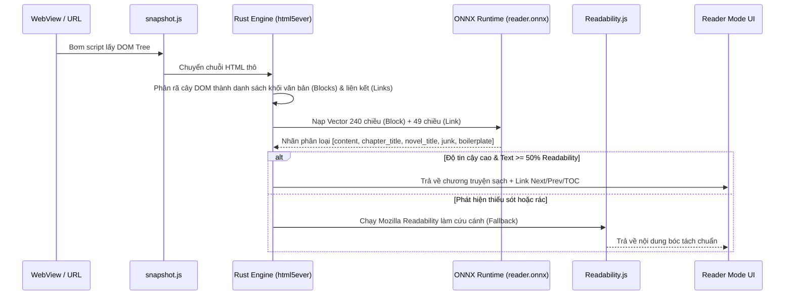

# Bản Thiết Kế Chi Tiết & Hướng Dẫn Triển Khai Xây Dựng Ứng Dụng Readexa (Production Blueprint)

Tài liệu này bổ sung toàn bộ các chi tiết kỹ thuật ở cấp độ lập trình (Implementation-level specifications) còn thiếu từ bản phân tích kiến trúc, giúp lập trình viên có thể bắt tay vào khởi tạo dự án và viết mã (code) ngay lập tức.

---

## 1. Cấu Hình Dự Án & Quản Lý Thư Viện

### 1.1. `pubspec.yaml` (Flutter Project Configuration)
```yaml
name: reader_browser
description: "Advanced Multi-Format E-Reader, Web Novel Distiller & Neural TTS Assistant"
publish_to: "none"
version: 1.0.0+1

environment:
  sdk: ">=3.3.0 <4.0.0"
  flutter: ">=3.19.0"

dependencies:
  flutter:
    sdk: flutter
  flutter_localizations:
    sdk: flutter

  # State Management & Utilities
  flutter_riverpod: ^2.5.1
  rxdart: ^0.27.7
  equatable: ^2.0.5
  uuid: ^4.3.3
  intl: ^0.19.0
  collection: ^1.18.0

  # Local Storage & Database
  sembast: ^3.7.1+1          # NoSQL Document Store cho Sách, Ghi chú, Cài đặt
  sqflite: ^2.3.3+1          # Cache dữ liệu quan hệ
  path_provider: ^2.1.2
  shared_preferences: ^2.2.2

  # Document & E-book Rendering
  pdfrx: ^1.0.64             # PDF viewer engine nền PDFium
  flutter_quill: ^10.1.0     # Trình soạn thảo đánh giá sách (Rich text)
  flutter_widget_from_html: ^0.14.11
  scrollable_positioned_list: ^0.3.8

  # Web Engine & Content Scraper
  webview_flutter: ^4.7.0
  html: ^0.15.4

  # Audio & Offline Neural TTS
  just_audio: ^0.9.36
  audio_service: ^0.18.12
  audio_session: ^0.1.18
  wakelock_plus: ^1.2.0

  # FFI & Rust Bridge
  flutter_rust_bridge: 2.0.0 # Giao tiếp FFI tốc độ cao với Rust
  ffi: ^2.1.2

  # Cloud & System Integrations
  google_sign_in: ^6.2.1
  googleapis: ^13.1.0        # Google Drive AppData Sync
  firebase_core: ^2.27.0
  firebase_auth: ^4.17.8
  cloud_firestore: ^4.15.8
  in_app_purchase: ^3.1.13
  google_mobile_ads: ^5.1.0
  receive_sharing_intent: ^1.4.5
  share_plus: ^9.0.0
  screenshot: ^3.0.0
  flutter_local_notifications: ^17.1.0

dev_dependencies:
  flutter_test:
    sdk: flutter
  flutter_lints: ^3.0.0
  build_runner: ^2.4.8

flutter:
  uses-material-design: true
  assets:
    - assets/brand/
    - assets/js/
    - assets/readexa/
    - assets/translations/
    - assets/translation/
    - assets/sample_books/
    - assets/lottie/
  shaders:
    - packages/flutter_page_curl/shaders/page_curl_readexa.frag
```

### 1.2. `Cargo.toml` (Rust Core Engine - `native/readexa_core`)
```toml
[package]
name = "readexa_core"
version = "0.1.0"
edition = "2021"

[lib]
crate-type = ["cdylib", "staticlib"]

[dependencies]
flutter_rust_bridge = "=2.0.0"
html5ever = "0.26"        # Parser HTML DOM chuẩn Mozilla
tokenizers = "0.15"       # HuggingFace Tokenizer siêu tốc
tokio = { version = "1.36", features = ["full"] }
serde = { version = "1.0", features = ["derive"] }
serde_json = "1.0"
anyhow = "1.0"
url = "2.5"
```

---

## 2. Chi Tiết Lược Đồ Dữ Liệu (Data Models & Sembast Store Schema)

Ứng dụng lưu trữ dữ liệu dưới dạng các NoSQL Document Store trong Sembast. Dưới đây là cấu trúc JSON chi tiết của từng thực thể cốt lõi:

### 2.1. Sách / Tài liệu (`local_documents` Store)
```dart
class LocalDocument {
  final String id;             // UUID v4
  final String title;          // Tiêu đề sách / tiểu thuyết
  final String author;         // Tác giả
  final String filePath;       // Đường dẫn file cục bộ (.epub, .pdf, .mobi, .cbz)
  final String? coverPath;     // Đường dẫn ảnh bìa được trích xuất
  final String format;         // "epub" | "pdf" | "mobi" | "cbz" | "web_novel"
  final String? sourceUrl;     // URL gốc nếu tải từ Web
  final double progress;       // 0.0 -> 1.0 (Tiến độ đọc)
  final String? currentLocator;// EPUB CFI hoặc Trang PDF hiện tại
  final int totalPages;        // Tổng số trang hoặc tổng số chương
  final int currentPage;      // Trang hoặc chương hiện tại
  final int lastReadTime;      // Epoch milliseconds
  final int createdAt;         // Epoch milliseconds
  final List<String> tagIds;   // Danh sách ID nhãn phân loại
  final String? seriesId;      // Thuộc bộ truyện nào
  final int? seriesOrder;      // Tập số mấy trong bộ
  final Map<String, dynamic>? customSettings; // Cài đặt hiển thị riêng cho cuốn sách này

  Map<String, dynamic> toMap() => {
    'id': id,
    'title': title,
    'author': author,
    'filePath': filePath,
    'coverPath': coverPath,
    'format': format,
    'sourceUrl': sourceUrl,
    'progress': progress,
    'currentLocator': currentLocator,
    'totalPages': totalPages,
    'currentPage': currentPage,
    'lastReadTime': lastReadTime,
    'createdAt': createdAt,
    'tagIds': tagIds,
    'seriesId': seriesId,
    'seriesOrder': seriesOrder,
    'customSettings': customSettings,
  };
}
```

### 2.2. Đoạn Đánh Dấu & Ghi Chú (`highlights` Store)
```dart
class Highlight {
  final String id;             // UUID
  final String documentId;     // Khóa ngoại liên kết LocalDocument
  final String text;           // Đoạn văn bản được tô sáng
  final String? note;          // Ghi chú của người dùng
  final String colorHex;       // Ví dụ: "#FFE082" (Vàng), "#80CBC4" (Xanh ngọc)
  final String locator;        // Vị trí chính xác (EPUB CFI hoặc PDF Rect coordinates)
  final int pageIndex;         // Trang số mấy
  final int createdAt;         // Epoch ms
  final String? postItColor;   // Màu giấy ghi chú Post-it nếu là ghi chú dán
  final List<String> tags;     // Phân loại ghi chú

  Map<String, dynamic> toMap() => {
    'id': id,
    'documentId': documentId,
    'text': text,
    'note': note,
    'colorHex': colorHex,
    'locator': locator,
    'pageIndex': pageIndex,
    'createdAt': createdAt,
    'postItColor': postItColor,
    'tags': tags,
  };
}
```

### 2.3. Sổ Từ Vựng Flashcard (`vocabulary` Store)
```dart
class VocabularyEntry {
  final String id;
  final String word;           // Từ gốc
  final String definition;     // Nghĩa tra cứu từ API
  final String? phonetic;      // Phiên âm IPA (/həˈloʊ/)
  final String? contextSentence;// Câu ngữ cảnh trong cuốn sách
  final String documentId;     // Sách chứa từ này
  final String language;       // "en", "zh", "ja", "ko", etc.
  final int status;            // 0: Needs review, 1: Learning, 2: Learned
  final int nextReviewTime;    // Epoch ms (Spaced Repetition Algorithm)
  final int intervalDays;      // Khoảng cách lặp lại (1, 3, 7, 14, 30 ngày)
  final int reviewCount;       // Số lần đã ôn tập thành công

  Map<String, dynamic> toMap() => {
    'id': id,
    'word': word,
    'definition': definition,
    'phonetic': phonetic,
    'contextSentence': contextSentence,
    'documentId': documentId,
    'language': language,
    'status': status,
    'nextReviewTime': nextReviewTime,
    'intervalDays': intervalDays,
    'reviewCount': reviewCount,
  };
}
```

### 2.4. Nhật Ký Đọc & Chuỗi Ngày Đọc (`reading_sessions` Store)
```dart
class ReadingSession {
  final String id;
  final String documentId;
  final int startTimestamp;    // Bắt đầu đọc
  final int durationSeconds;   // Thời gian đọc thực tế (chỉ tính khi app active)
  final int pagesRead;         // Số trang đã đọc trong phiên
  final String dateString;     // "YYYY-MM-DD" dùng cho biểu đồ Heatmap & Streak

  Map<String, dynamic> toMap() => {
    'id': id,
    'documentId': documentId,
    'startTimestamp': startTimestamp,
    'durationSeconds': durationSeconds,
    'pagesRead': pagesRead,
    'dateString': dateString,
  };
}
```

---

## 3. Các Luồng Thuật Toán Cốt Lõi (Core Pipelines Implementation)

### 3.1. Pipeline Bóc Tách Tiểu Thuyết Mạng (AI Web Novel Distillation)



**Thuật toán quyết định:**
1. Trích xuất văn bản từ thẻ HTML dạng khối (`<p>`, `<div>`, `<article>`).
2. Vector hóa đặc trưng: mật độ liên kết (`link_density`), chiều dài văn bản (`char_count`), chỉ số thẻ ngữ nghĩa, vị trí trong DOM.
3. Chạy mô hình `reader.onnx`:
   - Nếu `confidence >= 0.5` và `content_min_chars >= 200`: chấp nhận khối văn bản.
   - Nhận diện liên kết chuyển chương: link có text chứa "Chương sau", "Next Chapter", "下一章" được dán nhãn `next` với ngưỡng `link_min: 0.5`.

---

### 3.2. Pipeline Giọng Đọc Sách Ngoại Tuyến (Offline Neural TTS)

1. **Phân đoạn văn bản (`tts_text_segmenter.dart`):**
   - Tách văn bản của chương hiện tại thành từng câu ngắn dựa trên dấu kết thúc câu (`.`, `!`, `?`, `...`, `\n`).
2. **Grapheme-to-Phoneme (G2P):**
   - Chuyển chữ viết sang chuỗi âm vị âm học bằng bộ quy tắc `sea_g2p.bin` (cho tiếng Việt/tiếng Anh) hoặc `libespeak_phon.so`.
3. **Tổng hợp âm thanh (Sherpa-ONNX):**
   - Đưa chuỗi âm vị vào mô hình VITS/Piper ONNX (`libsherpa-onnx-c-api.so`).
   - Xuất mảng byte PCM 16-bit 22050Hz theo từng câu (`SequentialWavePlayer`).
4. **Đồng bộ giao diện (Karaoke-style Highlighting):**
   - Khi `AudioService` phát đến câu thứ $N$, gửi sự kiện qua `tts_speaking_tracker.dart`.
   - Reader View tự động cuộn màn hình đến câu tương ứng và áp dụng hiệu ứng đổi màu nền câu đang đọc.
5. **Chạy ngầm (Background Service):**
   - Đăng ký `com.ryanheise.audioservice.AudioService` trong AndroidManifest.
   - Hiển thị Media Notification với tên sách, tên chương, ảnh bìa, nút Play/Pause, tua 15 giây, chuyển chương.

---

### 3.3. Pipeline Dịch "Convert" Tiểu Thuyết Trung - Việt (Han-Viet Translation)

Dành riêng cho độc giả đọc truyện chữ Trung Quốc:
1. **Phát hiện & bảo vệ tên riêng (`name_detector.dart`):**
   - Dùng biểu thức chính quy và từ điển nhận diện họ tên nhân vật (2-4 chữ Hán), tên môn phái, địa danh.
   - Thay thế tạm thời bằng mã Token bảo vệ (ví dụ: `__NAME_TOKEN_001__`) để tránh bị dịch nghĩa từng từ.
2. **Quy tắc ngữ pháp / Luật nhân (`luat_nhan.dart`):**
   - Xử lý các đại từ nhân xưng: Ta, Ngươi, Hắn, Nàng, Bản tọa, Sư phụ, Lão đại...
   - Đảo ngữ các cụm từ chỉ thời gian, trạng thái, mức độ phù hợp với văn phong tiếng Việt.
3. **Tra cứu bảng từ điển ưu tiên:**
   - Cấp 1: Bảng thuật ngữ riêng của bộ truyện (`novel_glossary.json`).
   - Cấp 2: Bảng ghi đè từ điển cộng đồng (`zh-vi.hanviet.override.tsv`).
   - Cấp 3: Bảng Hán - Việt tiêu chuẩn (`zh-vi.hanviet.tsv`).
4. **Phục hồi & Hậu biên tập (`postedit.dart`):**
   - Gắn lại tên riêng đã bảo vệ vào vị trí tương ứng và định dạng viết hoa chữ cái đầu danh từ riêng.

---

## 4. Kiến Trúc Quản Lý Trạng Thái (Riverpod Providers Map)

```
lib/
├── core/
│   ├── providers/
│   │   ├── app_theme_provider.dart        # Sáng, Tối, Sepia, OLED, E-ink
│   │   ├── audio_handler_provider.dart    # Điều khiển AudioService chạy nền
│   │   └── drive_sync_provider.dart       # Quản lý tiến trình đồng bộ Google Drive
│   └── services/
│       └── tts/
├── data/
│   ├── datasources/
│   │   └── app_database.dart              # Khởi tạo Sembast DB & SQLite
│   └── repositories/
├── features/
│   ├── home/
│   │   └── providers/
│   │       ├── home_spotlight_provider.dart # Sách đọc gần nhất & tiến độ ngày
│   │       └── reading_streak_provider.dart # Dữ liệu chuỗi ngày đọc
│   ├── library/
│   │   └── providers/
│   │       ├── library_books_provider.dart  # Danh sách sách, lọc theo tag/series
│   │       └── opds_catalog_provider.dart   # Sách từ OPDS feeds
│   ├── reader/
│   │   └── providers/
│   │       ├── current_book_provider.dart   # Dữ liệu cuốn sách đang mở
│   │       ├── reader_settings_provider.dart# Cỡ chữ, khoảng cách dòng, lề, font
│   │       └── highlight_list_provider.dart # Toàn bộ highlight của sách hiện tại
│   └── background_sound/
│       └── providers/
│           └── bgm_controller_provider.dart # Phát âm thanh tiếng mưa, quán cafe
```

---

## 5. Quy Chuẩn Đồng Bộ Google Drive (Sync Ledger Protocol)

Để tránh xung đột khi đọc trên nhiều điện thoại và máy tính bảng:
1. **Thư mục lưu trữ:** Sử dụng thư mục ẩn `appDataFolder` trên Google Drive (người dùng không vô tình xóa nhầm).
2. **Tệp sổ cái (`sync_ledger.json`):**
   ```json
   {
     "device_id": "android_uuid_abc123",
     "version": 1,
     "last_synced_at": 1730209500000,
     "entries": [
       {
         "document_id": "doc_01",
         "file_hash": "sha256_hash_here",
         "progress": 0.45,
         "current_locator": "epubcfi(/6/14[chapter03]!/4/2/4:0)",
         "last_read_time": 1730209450000,
         "highlights_count": 12,
         "action": "upsert"
       }
     ]
   }
   ```
3. **Chiến lược giải quyết xung đột (Conflict Resolution):**
   - Dùng chính sách **Last-Write-Wins (LWW)** dựa trên `last_read_time`.
   - Nếu tiến độ đọc trên thiết bị B có `last_read_time` mới hơn thiết bị A, thiết bị A sẽ tự động hiển thị thanh thông báo: *"Bạn đang đọc đến trang X trên thiết bị khác. Nhấn để đồng bộ"*.

---

## 6. Lộ Trình Triển Khai Thực Tế (Actionable Implementation Roadmap)

| Giai đoạn | Mục tiêu triển khai | Thời gian ước tính |
|---|---|---|
| **Phase 1** | Khởi tạo khung Flutter + Sembast DB + CRUD sách cơ bản + Theme Material UI | 1 - 2 tuần |
| **Phase 2** | Tích hợp Trình đọc EPUB (`scrollable_positioned_list`) + Trình đọc PDF (`pdfrx` / PDFium) | 2 tuần |
| **Phase 3** | Xây dựng trình duyệt bóc tách Web Novel (`webview_flutter` + Rust `html5ever` + Readability) | 2 tuần |
| **Phase 4** | Tích hợp Audio Engine & Offline TTS (Sherpa-ONNX + Piper + Android `AudioService`) | 2 - 3 tuần |
| **Phase 5** | Bộ công cụ dịch Hán-Việt Convert + Manga OCR (PaddleOCR PP-OCRv5) | 2 tuần |
| **Phase 6** | Đồng bộ Google Drive + Thống kê đọc sách (Streak/Milestones) + Android App Widgets | 1 - 2 tuần |
| **Phase 7** | Gói Pro In-App Purchase + Tối ưu hiệu năng bộ nhớ & Đóng gói phát hành | 1 tuần |
